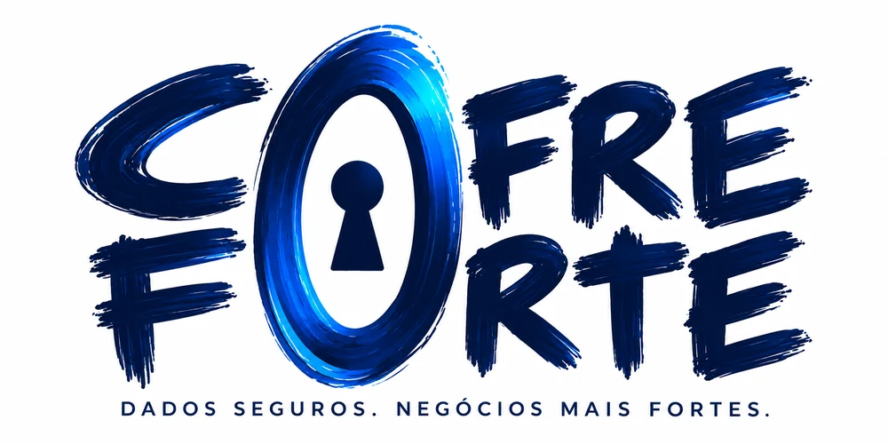

<p align="center">
  
</p>

# Cofre Forte

Criptografe e descriptografe arquivos e pastas **direto no navegador**. Nada é enviado a servidor algum: senha, arquivos e chaves existem apenas na memória da aba.

Interface construída sobre os tokens e padrões do [IBM Carbon Design System](https://github.com/carbon-design-system/carbon) (temas White e Gray 100).

## Funcionalidades

- **AES-256-GCM**: criptografia autenticada; qualquer alteração no arquivo faz a descriptografia falhar.
- **Senha + keyfile (2FA)**: o material da chave é a senha somada ao SHA-256 de um arquivo qualquer.
- **Blocos de 1 MiB**: cada bloco tem IV único, e índice e posição final são autenticados (reordenar ou truncar é detectado).
- **Fila em lote**: arraste arquivos ou pastas inteiras.
- **Telemetria**: progresso, velocidade (MB/s) e tempo restante.
- **Tema claro/escuro** e layout responsivo.

## Como rodar

Requer Node.js 18 ou superior.

```bash
npm install
npm run dev      # http://localhost:5173
npm test         # testes do motor criptográfico (Vitest)
npm run build    # gera ./dist
```

A Web Crypto API exige contexto seguro: use `localhost` ou HTTPS.

### Publicar

- **GitHub Pages (automático)**: o repositório já inclui `.github/workflows/deploy.yml`. Em *Settings → Pages → Build and deployment → Source*, escolha **GitHub Actions**. A cada push na `main` o projeto é testado, compilado e publicado.
- **Vercel / Netlify**: importe o repositório (build: `npm run build`, saída: `dist`).

O build usa caminhos relativos, então funciona na raiz do domínio e em subpastas como `usuario.github.io/repositorio/`. Não publique a pasta do código-fonte: o que vai ao ar é o conteúdo de `dist`.

## Como usar

1. Digite a senha mestra (mínimo de 8 caracteres para criptografar) e, se quiser, solte um keyfile.
2. Escolha **Criptografar** ou **Descriptografar**.
3. Adicione arquivos ou pastas e clique no botão de ação.
4. Use **Salvar** em cada item ou **Salvar todos**.

Para descriptografar é preciso a mesma senha e o mesmo keyfile. **Não há recuperação**: sem as credenciais, os dados são irrecuperáveis.

## Segurança

| Item | Valor |
| --- | --- |
| Cifra | AES-256-GCM (tag de 128 bits) |
| Derivação | PBKDF2 com HMAC-SHA-256, 600.000 iterações |
| Salt | 32 bytes aleatórios por arquivo |
| IV | 12 bytes aleatórios por bloco |
| Keyfile | `senha ∥ SHA-256(keyfile)` |
| AAD por bloco | índice (u32 LE) + flag de último bloco |

Esta aplicação não passou por auditoria independente. Para dados críticos, avalie ferramentas auditadas.

## Formato `.cofre` (v1)

| Offset | Tamanho | Conteúdo |
| --- | --- | --- |
| 0 | 5 | Magic `COFRE` |
| 5 | 1 | Versão (`0x01`) |
| 6 | 4 | Iterações PBKDF2 (u32 LE) |
| 10 | 32 | Salt |
| 42 | 4 | Tamanho do bloco 1 cifrado (u32 LE) |
| 46 | 12 | IV do bloco 1 |
| 58 | N | Bloco 1 cifrado + tag (16 bytes) |
| … | … | Repete para os demais blocos |

Não é compatível com arquivos `.aegis`.

## Estrutura

```
cofre-forte/
├── .github/workflows/ # deploy automático no GitHub Pages
├── index.html
├── public/            # logo e favicon
├── src/
│   ├── app.js         # interface: credenciais, fila, progresso, log
│   ├── crypto.js      # motor AES-GCM / PBKDF2 / formato .cofre
│   └── styles.css     # tokens e componentes no padrão Carbon
└── tests/
    └── crypto.test.js # ida e volta, senha/keyfile errados, adulteração, truncamento
```

## Limitações

- O resultado fica em memória até ser salvo; arquivos de vários GB dependem da RAM do dispositivo.
- Pastas são processadas arquivo a arquivo (o caminho vai no nome: `pasta__sub__arquivo.ext.cofre`), não em um pacote único.
- Navegadores podem pedir permissão para vários downloads seguidos.

## Licença

[MIT](LICENSE)
